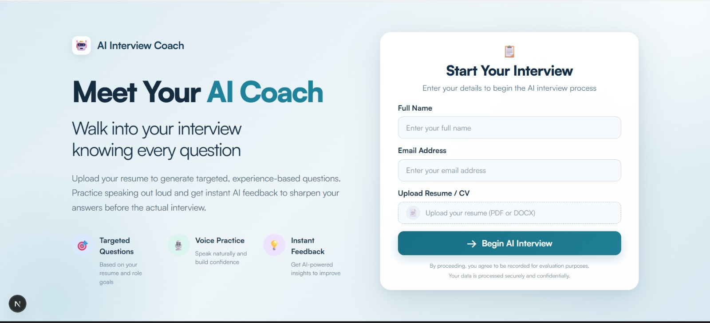
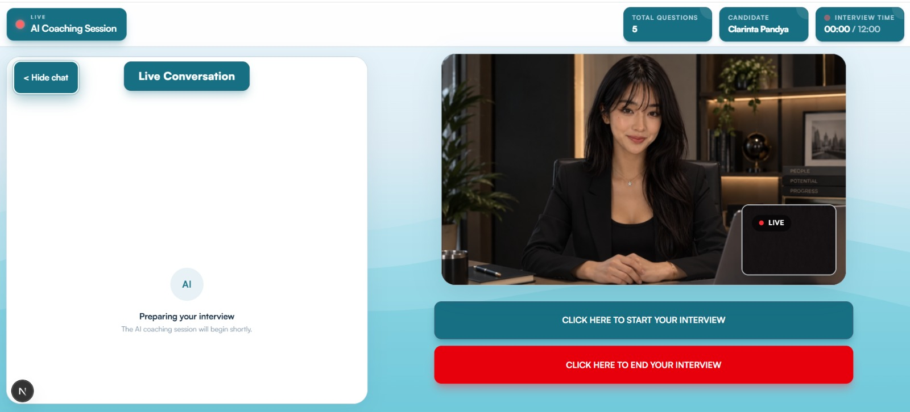
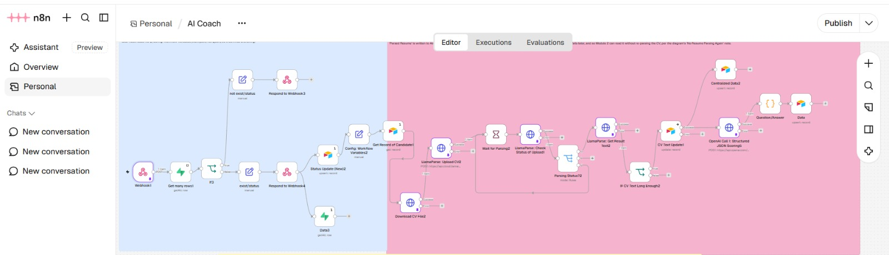
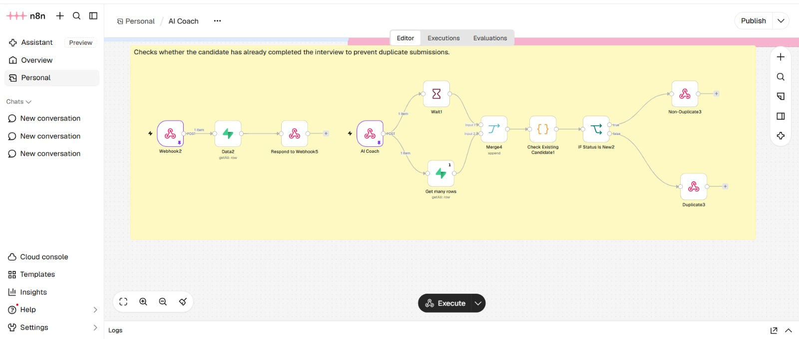

# AI-Powered Coaching & Practice Interview System


---

## 📺 System Walkthrough

🎥 Watch the complete demonstration of the AI Coaching & Practice Interview System:

https://www.loom.com/share/ce6077592a2e4ce585092d8268c05152

---

## 🚀 Project Overview

The **AI-Powered Coaching & Practice Interview System** is a subscription-based SaaS product designed to help candidates prepare for real job interviews through personalized, AI-generated questions, voice-based practice sessions, and instant AI feedback.

Candidates can upload their resumes, enter their personal details, and start interactive coaching sessions. The system processes their resumes to generate targeted, experience-based questions, allowing them to practise speaking their answers and receive AI-powered insights to improve their interview performance.

The platform combines an interactive AI coaching experience with automated n8n workflows for candidate validation, resume parsing, AI processing, and question generation.

---
## 💼 SaaS Product Model

A **subscription-based SaaS product for interview preparation**, providing candidates with personalized AI-generated interview questions, interactive voice practice sessions, and instant AI-powered feedback to help them improve their answers and prepare for real job interviews.

---

## 🖥️ Application Interface

### 1️⃣ AI Coach Landing Page & Resume Submission

Candidates begin by visiting the AI Coach application and entering their personal details.

**Required information:**
- Full Name
- Email Address
- Resume / CV Upload (PDF or DOCX)

The uploaded resume is used to generate targeted, experience-based interview questions.

The landing page introduces three main features:

- **🎯 Targeted Questions:** Questions based on the candidate's resume and role goals.
- **🎙️ Voice Practice:** Practise speaking naturally and build confidence.
- **💡 Instant Feedback:** Receive AI-powered insights to improve answers before the actual interview.

<div align="center">
  
</div>

---

### 2️⃣ Interactive AI Coaching Session

After submitting their details and resume, candidates enter the live AI coaching session.

The interface provides an interactive practice environment featuring an AI coach avatar and a live conversation panel.

**Session interface includes:**

- AI Coach Video Interface
- Live Conversation Panel
- Total Question Counter
- Interview Session Timer

The displayed session includes **5 practice questions** and a **12-minute session duration**.

Candidates can practise answering questions through voice interaction in a simulated interview environment.

<div align="center">
  
</div>

---

## ⚙️ Backend Automation with n8n

The backend automation is managed through n8n workflows, connecting candidate submissions, resume processing, AI services, and data management.

### 3️⃣ Resume Ingestion & Candidate Processing

When a candidate submits their information, the application sends the data to an n8n webhook.

The workflow handles:

- Receiving candidate submission data.
- Checking candidate status.
- Identifying existing submissions to avoid duplication.


### 4️⃣ Resume Parsing & Validation

The uploaded resume is processed using **LlamaParse**.

The workflow handles:

- Uploading the resume for parsing.
- Retrieving extracted resume text.
- Validating extracted resume content to generate Questions.

### 5️⃣ AI-Powered Question Generation & Processing

After successful resume processing, the extracted information is sent to an OpenAI-powered workflow.

The workflow uses structured JSON processing to organize AI-generated question and answer information for the coaching system.

This supports personalized interview practice based on the candidate's resume and experience.

<div align="center">
  
</div>

---

### 6️⃣ Candidate Validation & Duplicate Prevention

The system includes a separate candidate validation workflow to check whether a candidate has already completed or submitted an existing coaching session.

The workflow:

- Receives candidate information through a webhook.
- Checks candidate status.
- Routes records based on their status.
- Separates duplicate and non-duplicate submissions.

This helps prevent duplicate candidate processing.

<div align="center">
  
</div>

---

## 🛠️ Technical Stack

| Layer | Technology |
|---|---|
| **Frontend Application** | Next.js |
| **Programming Language** | TypeScript / JavaScript |
| **Workflow Automation** | n8n |
| **AI Processing** | OpenAI |
| **Resume Parsing** | LlamaParse |
| **Backend Integration** | Webhooks & APIs |
| **Candidate Processing** | Automated n8n Workflows |
| **Interview Experience** | Voice-Based AI Coaching Interface |

---

## 🔄 System Architecture

```text
             AI COACH SAAS APPLICATION
                       ↓
              Candidate Registration
                       ↓
                Resume Upload
                       ↓
                 n8n Webhook
                       ↓
            Candidate Data Validation
                       ↓
               Duplicate Check
                       ↓
              Resume Processing
                       ↓
                  LlamaParse
                       ↓
             Extracted Resume Text
                       ↓
               Resume Validation
                       ↓
              OpenAI AI Processing
                       ↓
          Structured Questions & Answers
                       ↓
               AI COACH INTERFACE
                       ↓
           Interactive Practice Session
                       ↓
              Voice-Based Answers
                       ↓
               AI-Powered Feedback
```

---

## 🚀 Business Impact

The platform transforms traditional interview preparation into a personalized, subscription-based AI coaching experience.

### Before Automation

**Search Interview Questions → Read Generic Questions → Prepare Answers Manually → Practise Without Feedback → Identify Weaknesses Independently**

### After Automation

**Access AI Coach SaaS Platform → Upload Resume → Generate Targeted Questions → Start AI Coaching Session → Practise Through Voice → Receive AI Feedback → Improve Interview Answers**

### Key Benefits

- **🎯 Personalized Preparation:** Generates questions based on individual resume information.
- **🎙️ Speaking Practice:** Helps candidates practise verbal responses.
- **💡 Immediate Insights:** Provides AI-powered feedback to support improvement.
- **⏱️ Structured Sessions:** Organizes practice around a defined question count and session duration.
- **⚙️ Automated Processing:** Reduces manual work involved in resume preparation and question generation.
- **☁️ SaaS Accessibility:** Makes AI-powered interview coaching available through an online platform.
- **🚀 Interview Readiness:** Helps candidates prepare more effectively for actual job interviews.

---

## 📌 Key Result

Developed an **AI-powered, subscription-based SaaS coaching platform** that connects resume parsing, personalized interview question generation, voice-based practice, and AI-powered feedback in one automated solution.

**SaaS Platform → Resume Upload → Resume Parsing → AI Question Generation → Interactive Voice Practice → AI Feedback → Interview Preparation**

The platform provides candidates with an accessible and personalized interview preparation experience while delivering the underlying processing through automated AI workflows.

---

## ✍️ Author

**Muneeb Ali Khan**

**AI Automation & GTM Engineer**

- **LinkedIn:** [Muneeb Ali Khan](https://www.linkedin.com/in/muneeb-ali-khan-2a1675365)
